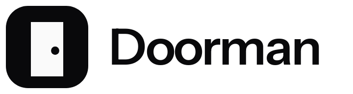
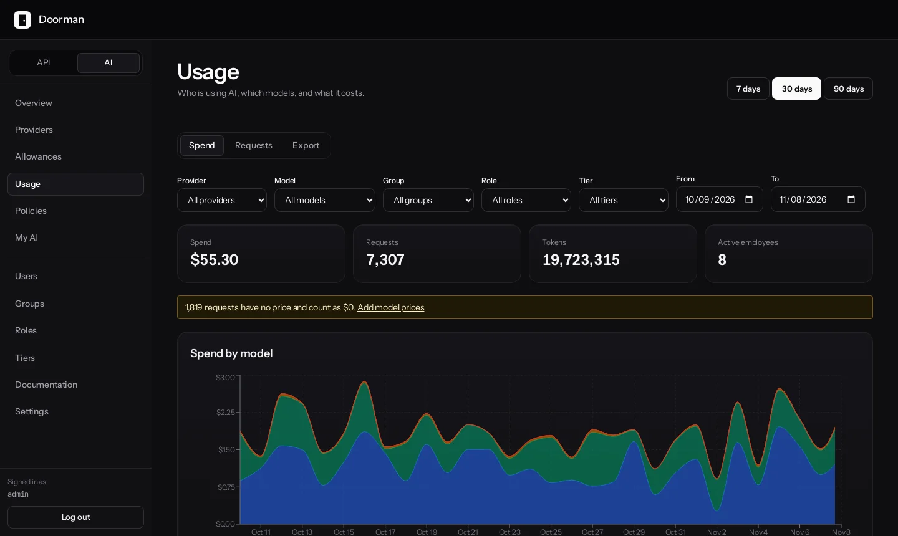
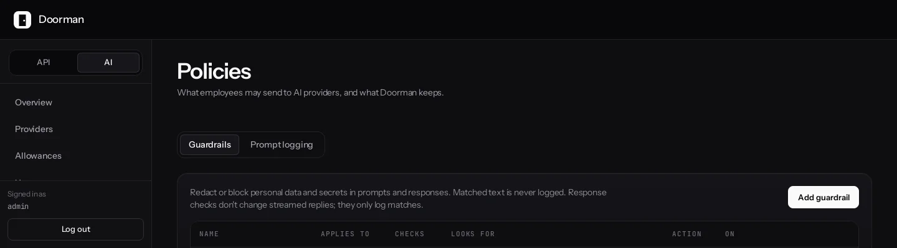
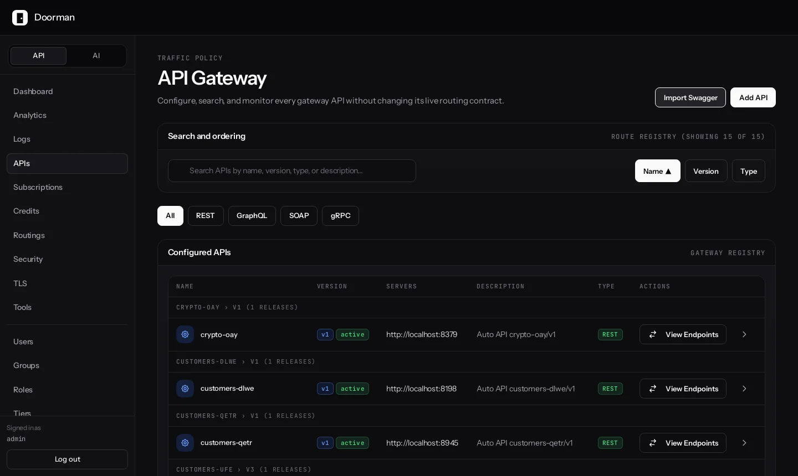
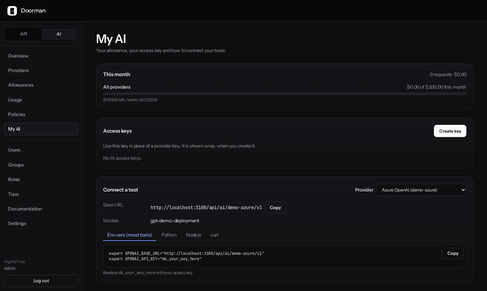

<picture>
  <source media="(prefers-color-scheme: dark)" srcset="docs/images/doorman-logo-dark-mode.png">
  
</picture>


### One gateway for your team's AI and APIs.

Give people AI with personal keys and allowances, put your APIs behind one set of
policies, and see every request and every dollar. In your own infrastructure.

[Run the AI demo](#ai-demo-no-provider-key-needed) · [Self-host](#self-hosting) · [doorman.dev](https://doorman.dev) · [Request a pilot](https://doorman.dev/contact.html?interest=pilot)



## What it does

**AI gateway**

- One endpoint for OpenAI, Anthropic, Gemini, Azure OpenAI and any OpenAI-compatible model
- Personal `dk_` keys for each employee; provider keys never leave the gateway
- Allowances in dollars, tokens or requests, per person, group, tier or API, that warn, block or switch to a smaller model
- Backup providers on outages, model allow lists and aliases
- Guardrails that redact, block or log secrets and personal data in prompts and responses
- Spend and usage by person, team, model and provider, with your own contract prices

**API gateway**

- REST, SOAP, GraphQL, native gRPC and gRPC-Web behind one set of policies
- Users, roles, groups, subscriptions, credits, tiers and quotas
- Rate limits, throttling, bandwidth limits, routing, retries, circuit breaking and schema validation
- Versioned APIs with deprecation and sunset dates
- Request logs, analytics, audit trail, and configuration import and export

**Runs where you do**

- One container: a Rust gateway with the dashboard built in
- In-memory mode with encrypted snapshots for a single node, or MongoDB and Redis for several
- Multi-arch images (amd64, arm64) with an SBOM and provenance

**Guardrails:** redact or block secrets and personal data before a prompt leaves your network.



**APIs:** every REST, SOAP, GraphQL and gRPC API behind one set of policies.



## Quick demo

```bash
cp .env.demo .env
docker compose -f docker-compose.yml -f docker-compose.demo.yml up
```

- Dashboard: [http://localhost:3000](http://localhost:3000)
- Gateway and platform API: [http://localhost:3001](http://localhost:3001)
- Sign in as `demo@doorman.dev` / `DemoPassword123!`
- Runs in memory, so MongoDB and Redis are not needed
- Listens on `127.0.0.1` only, because the login above is public. Set `DEMO_BIND_HOST=0.0.0.0` to expose it on your network.

### AI demo (no provider key needed)

The demo includes a keyless local model (`demo-local-llm/v1`). With the stack running:

```bash
./scripts/demo-ai-walkthrough.sh
```

It creates a team with a 3-request allowance, adds an employee who creates their own
AI key, sends 4 requests (the 4th is blocked with `AI004`), and prints the usage. It is
safe to re-run. To call the model yourself with an AI key from **My AI**:

```bash
curl http://127.0.0.1:3001/api/ai/demo-local-llm/v1/v1/chat/completions \
  -H "Authorization: Bearer dk_..." -H "Content-Type: application/json" \
  -d '{"model":"llama-demo","messages":[{"role":"user","content":"Hello"}]}'
```



## Self-hosting

Copy the template, then replace its deliberately invalid administrator credentials
and JWT secret before you start. The development defaults suit the bundled dashboard
at `http://localhost:3000`; set your TLS, CORS, issuer, audience and discovery values
before switching to `ENV=production`.

```bash
cp .env.example .env
docker compose up -d
```

The default is `MEM_OR_EXTERNAL=MEM`. For a shared, multi-instance deployment:

```bash
MEM_OR_EXTERNAL=REDIS docker compose --profile external up -d
```

Shared mode keeps configuration in MongoDB and caches, counters, revocations, routing
state and analytics in Redis.

Compose pulls the published image, `ghcr.io/doorman-dev/doorman`, pinned to the current
release. To build from source, add `--build` and set `DOORMAN_IMAGE=doorman:dev` so your
local build does not replace the release tag.

### Configuration

| Variable | Required | Description |
| :--- | :--- | :--- |
| `DOORMAN_ADMIN_EMAIL` | Yes | Initial administrator email |
| `DOORMAN_ADMIN_PASSWORD` | Yes | Initial administrator password |
| `JWT_SECRET_KEY` or `JWT_KEYS` | Yes | Access-token signing |
| `TOKEN_ENCRYPTION_KEY` | In production with MongoDB and Redis | Encrypts provider and API keys at rest; 32+ characters |
| `MEM_OR_EXTERNAL` | No | `MEM` (default) or `REDIS` for MongoDB plus Redis |
| `MEM_ENCRYPTION_KEY` | In memory mode | Encrypts memory snapshots |
| `MEM_DUMP_PATH` | No | Snapshot path; defaults to `data/memory_dump.bin` |
| `NEXT_PUBLIC_GATEWAY_URL` | No | Gateway URL for the browser; same origin by default |

Every variable is described in [Configuration](user-docs/02-configuration.md).

Self-registration at `/platform/authorization/register` is open without authentication
and limited by the registration IP rate limit.

## Repository structure

```text
doorman/
├── gateway-rs/             # Rust gateway and control plane
├── web-client/             # Next.js dashboard
├── parity/                 # Frozen pre-Rust public contract fixtures
├── user-docs/              # Guides and runbooks
├── scripts/                # Build and operational helpers
└── ops/                    # Infrastructure configuration
```

## Documentation

- [Getting started](user-docs/01-getting-started.md)
- [Configuration](user-docs/02-configuration.md)
- [Security and hardening](user-docs/03-security.md)
- [API workflows](user-docs/04-api-workflows.md)
- [Operations: backup, upgrades, key rotation, outages](user-docs/05-operations.md)
- [Tools](user-docs/06-tools.md)
- [Reverse proxy](user-docs/07-reverse-proxy.md)
- [AI gateway](user-docs/08-ai-gateway.md)
- [Testing](user-docs/TESTS.md)

Found a vulnerability? See [SECURITY.md](SECURITY.md).

## Working with us

Doorman is free to self-host under Apache 2.0. If you want help, we run assisted
pilots in your own cloud or VPC. [Request a pilot](https://doorman.dev/contact.html?interest=pilot).

## License

Copyright © Doorman Dev, LLC. Licensed under the Apache License 2.0.
